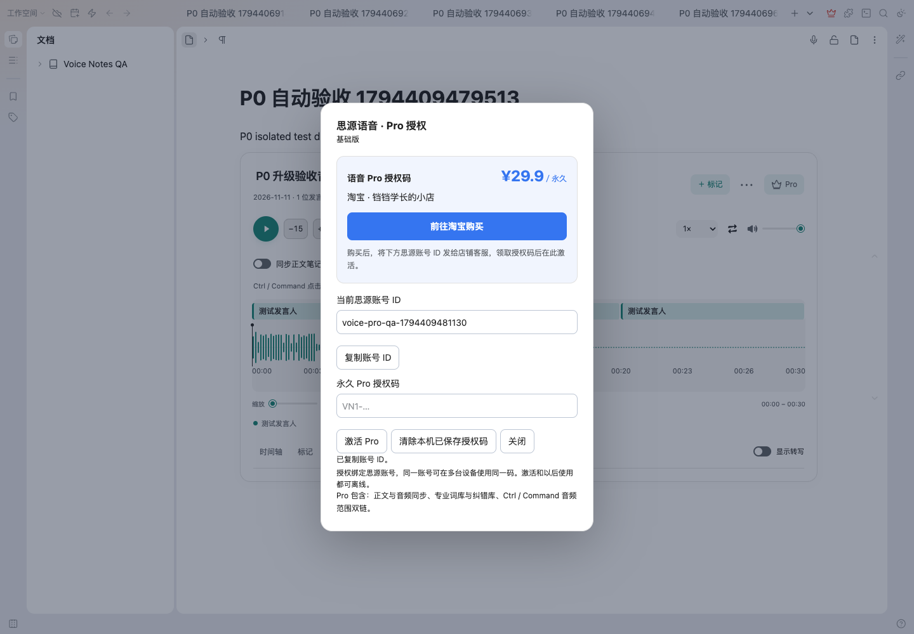
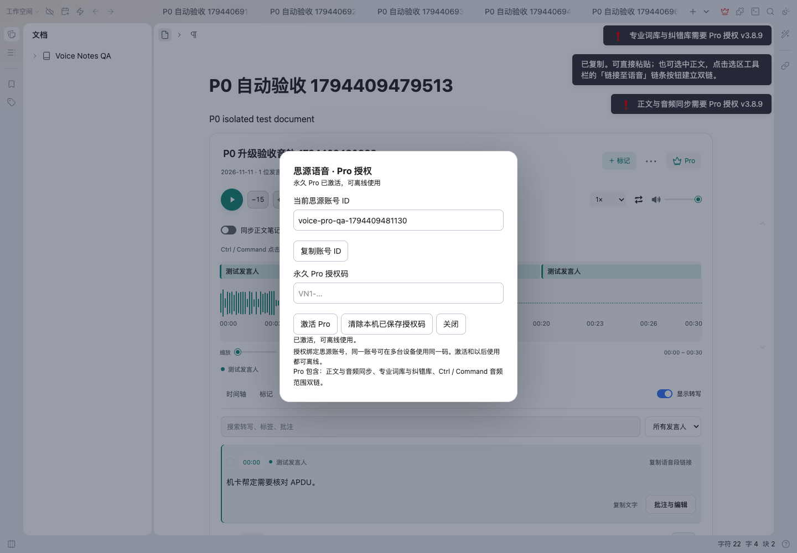
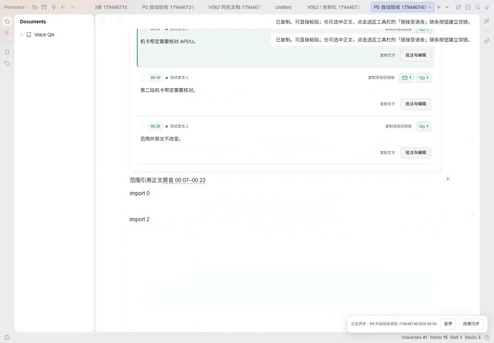
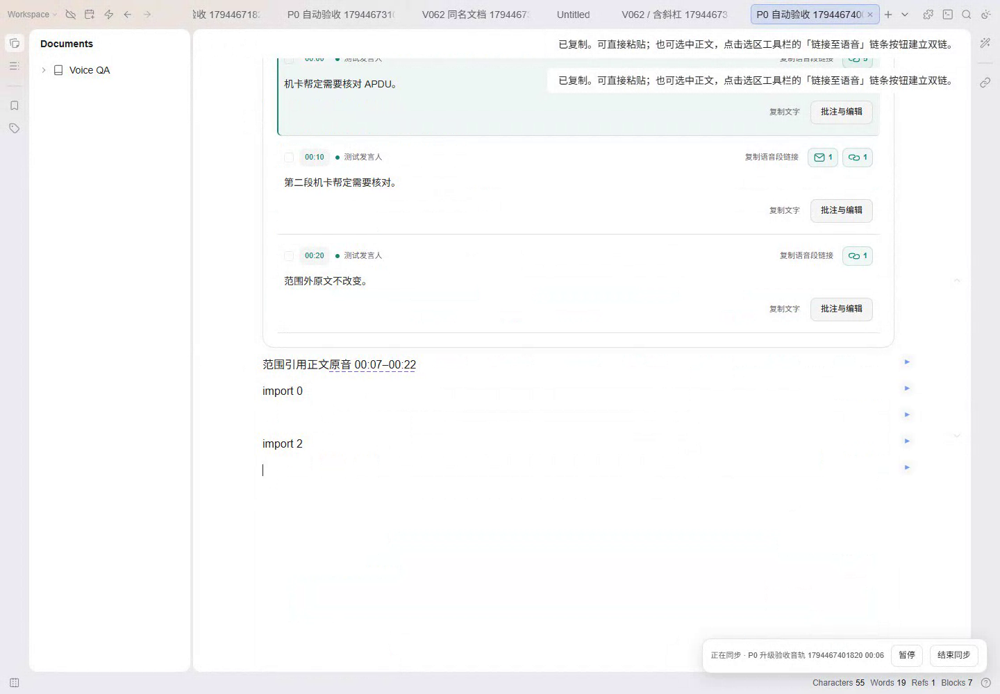
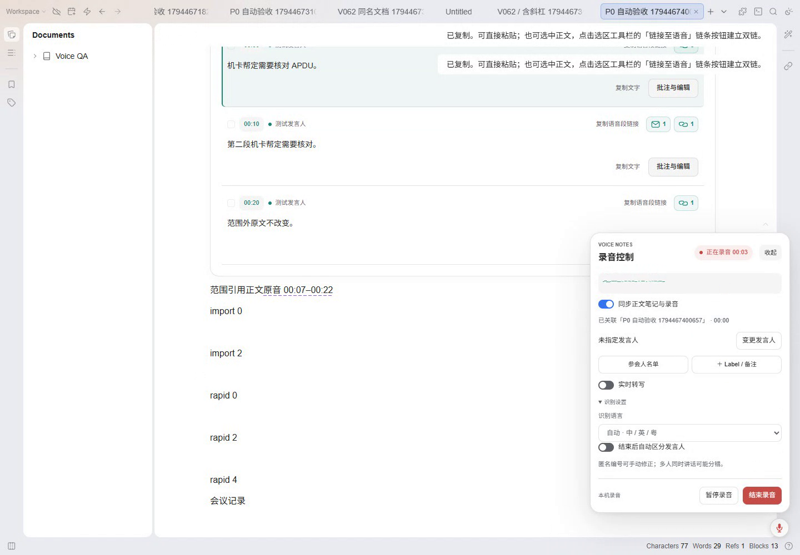
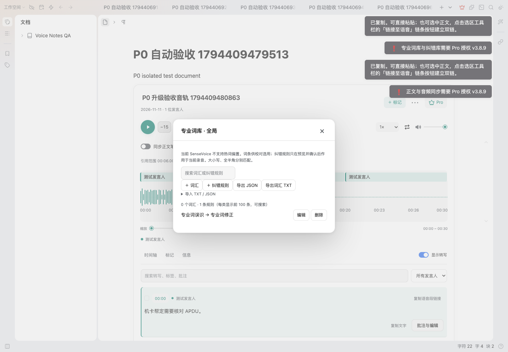
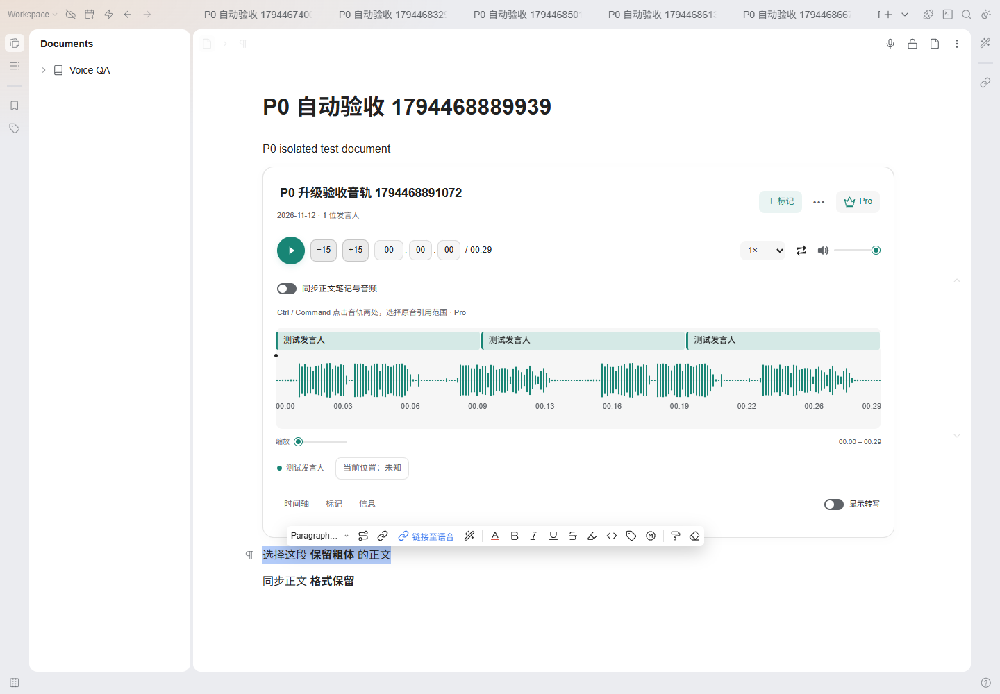
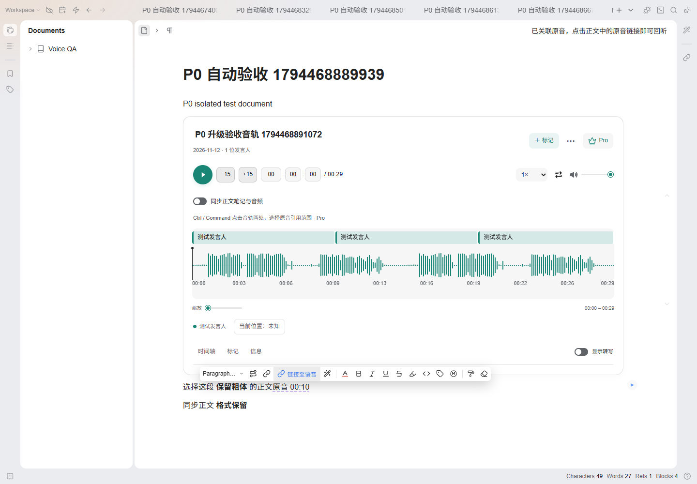
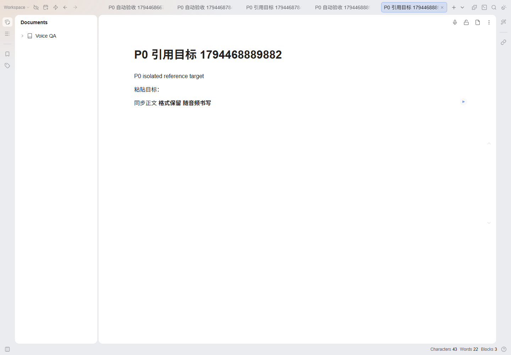

# 思源语音 Pro 使用说明

适用于 Voice Notes 0.8.2。Pro 为 29.9 元永久授权，包含正文与音频同步、专业词库与纠错、精确原音双链的创建与重新定位。Lite 和 Full 都支持这三项功能。使用 Lite 时，可以先导入录音和字幕，再进行整理。

本文按桌面操作编写。Windows 用 Ctrl，Mac 选音频范围时建议用 Command（⌘）。复制和粘贴分别用 Ctrl+C、Ctrl+V，Mac 用 Command+C、Command+V。

插图沿用项目中保存的隔离测试截图。授权与词库图来自 0.7.2 验证记录，正文同步与双链图来自 0.8.2 随包手册。按钮说明已按本地 0.8.2 源码核对，旧图中的个别用语以本文步骤为准。图中账号和正文均为测试样例。

## 激活 Pro

1. 打开一篇含有语音块的思源文档，在语音块右上角点击带皇冠的小按钮“Pro”。也可以从思源插件设置打开“思源语音 Voice Notes”，点击其中的 Pro 按钮。
2. 在“思源语音 · Pro 授权”窗口中，查看“当前思源账号 ID”，点击“复制账号 ID”。如果账号为空，先在思源中登录账号，再重新打开授权窗口。
3. 点击“前往淘宝购买”，按店铺流程购买后，把刚复制的思源账号 ID 发给客服，领取对应的语音 Pro 授权码。
4. 回到授权窗口，点击“永久 Pro 授权码”输入框，粘贴完整授权码，点击“激活 Pro”。输入框中按 Enter 也会提交激活。
5. 窗口显示“永久 Pro 已激活，可离线使用”后，点击“关闭”。此时可以继续使用下文的功能。

图 1。上方蓝色按钮打开淘宝店铺，中间按钮复制思源账号 ID，下方输入框填写授权码。这张图使用隔离测试账号，实际操作时应复制你自己的账号 ID。

图 2。激活成功后的窗口顶部显示“永久 Pro 已激活，可离线使用”。这是项目保存的测试授权效果图。

授权绑定思源账号。同一账号在另一台设备上使用时，安装插件并输入同一个授权码即可。激活及后续使用可离线进行。切换账号后，应使用新账号对应的授权码。“清除本机已保存授权码”用于移除当前账号在本机保存的码，之后可重新输入。

## 播放录音时，把正文关联到音频

这项功能适合边回听边记会议要点。先准备一条能正常播放的语音块，并在正文中留出写笔记的位置。

1. 在语音块播放器下方，打开“同步正文笔记与音频”开关。
2. 点击播放器的三角形播放按钮。右下角同步栏显示“正在同步”、录音标题和当前时间。若显示“同步已暂停”，点击同步栏里的“继续播放”。
3. 在思源正文中点击落笔的位置，输入第一条笔记。例如写“会后核对 APDU 参数”。按 Enter 换段，继续写下一条。
4. 新建段落或首次实际修改已有正文时，插件记录当时的音频位置。继续修改同一段会保留首次关联时间。单纯点击文字、选中或滚动页面不会建立关联。
5. 临时停止记笔记时，点击同步栏的“暂停”。继续时点“继续播放”。完成后点击“结束同步”，当前同步音频也会暂停。
6. 回到刚写的正文，点击段落右侧的小三角形按钮，回听这段笔记关联的原音。一个段落关联了多条录音时，先选择要听的来源。

图 3。右下角显示“正在同步”，并提供“暂停”和“结束同步”。检查这里的录音标题，确认正在跟随的是你要整理的录音。

图 4。正文输入后，段落右侧出现小三角形回听按钮。点击对应按钮可以回到该段的关联位置。图中的 import 0、import 2 是测试段落。

播放暂停期间不新增正文关联。需要更换来源录音时，在目标语音块开启同步并播放。同一窗口使用一个当前同步来源。

### 现场录音时同步记笔记

1. 点击文档顶部面包屑中的麦克风入口，选择“开始录音”。首次使用时按系统提示允许麦克风。
2. 打开录音控制面板，开启“同步正文笔记与录音”。
3. 回到思源正文正常输入，按 Enter 分段。可以切换到另一篇文档继续写。
4. 需要暂停时点击“暂停录音”，继续时使用录音控制里的继续按钮。
5. 结束时点击“结束录音”，等待语音块保存，再从正文右侧按钮回听。

图 5。录音控制面板中，“同步正文笔记与录音”处于开启状态，并显示已关联的文档与时间。这张历史测试图使用测试音频输入录音器。

### 调整回听位置

正文回听默认提前 3 秒开始，便于听到上下文。在插件设置中调整回听提前量，允许 0 至 30 秒。填 0 会从关联时刻开始，设置在下次回听时生效。

自动关联的时间需要调整时，先播放目标录音并定位，再右键点击正文旁的回听按钮，进入关联管理，选择“重新绑定当前播放时间”，核对表单后确认。原片段长度会保留。取消自动关联可在同一管理窗口选择“取消关联”。

## 建立词库并修正逐字稿

专业词汇用于校对时选词，纠错规则用于把指定错词替换成正确词。当前 SenseVoice 转写链路不支持词库热词偏置，新增词条后仍需校对转写结果。

### 添加通用词汇和纠错规则

1. 打开思源插件设置，找到“思源语音 Voice Notes”。
2. 在“专业词库”设置项点击“管理全局词库”。
3. 点击“＋ 词汇”，在“词汇”输入框填写正确术语，例如“APDU”，点击表单中的“保存”。
4. 点击“＋ 纠错规则”，在“错误识别”中输入常见错词，例如“机卡帮定”，在“正确词汇”中输入“机卡绑定”，点击“保存”。
5. 在“搜索词汇或纠错规则”输入框中搜索刚添加的内容，核对规则的方向。以后可用该行的“编辑”或“删除”维护词库。

图 6。列表中已经保存了一条“专业词误识 → 专业词修正”规则，右侧提供编辑和删除按钮。旧图中的“＋ 词汇”“＋ 纠错规则”与当前版本对应。

### 只给一条录音添加专用规则

1. 在目标语音块右上角点击“•••”，展开“更多操作”。
2. 点击“本条录音附加词库”。
3. 用“＋ 词汇”或“＋ 纠错规则”添加内容并保存。当前录音的词库保存后会关闭窗口，需要继续添加时重新打开。
4. 本条录音和全局词库存在相同错误词时，校对这条录音会采用其附加词库中的规则。

### 预览并批量替换

1. 打开目标语音块的“更多操作”，点击“按纠错词库预览替换”。
2. 在“批量纠错预览 · 仅本条录音”窗口核对录音标题、受影响语段数和匹配处数。
3. 逐条查看删除线标出的旧文字和下方的新文字。若有误替换，点“取消”，修改词库后重新预览。
4. 核对后点击“确认替换本条录音”。回到逐字稿检查改后的术语。规则应用于这条录音，时间与发言人信息保留。
5. 需要恢复最近一次批量操作时，在“更多操作”中选择“撤销上次批量纠错 / 重转写”。如果这之后又修改了相关内容，插件可能拒绝撤销，以免覆盖新修改。

预览窗口没有匹配结果时，先核对错词的大小写、全角半角以及原文写法。规则按精确文本匹配。

### 校对当前词汇并记住规则

1. 打开“显示转写”，找到要校对的语段。
2. 在语段的“批注与编辑”中点击“校对词汇 / 加入词库”。
3. 填写“错误词汇”和“正确词汇”。已选中的错词可自动带入，使用前再核对一次。
4. 只改当前出现处时点击“修改当前词汇”。想检查整条录音中的相同错误时，点击“预览本条录音全部替换”，再确认替换。
5. 希望以后复用这条规则，可勾选“同时加入个人纠错规则”。只存词条或规则时，分别点“仅加入词库”或“仅加入纠错规则”。

### 导入、导出词库

在词库窗口点击“导出 JSON”，可保存词汇和纠错规则。“导出词汇 TXT”只导出词汇，每行一个。

导入时展开“导入 TXT / JSON”，选择不超过 2 MiB 的文件，核对词汇数和规则数。遇到相同错误词时，选择“保留已有”或“使用导入规则”，然后点击“保存”。复用完整纠错库应选择 JSON。

## 用音频时间段建立正文双链

### 选取一段原音

1. 打开来源语音块，找到波形音轨。需要更细的位置时，先调整“缩放”滑块。
2. Windows 按住 Ctrl，Mac 按住 Command，在波形上的起点单击一次。提示会显示已经选择的时间。
3. 继续按住同一修饰键，在终点单击一次。界面显示“引用范围”及起止时间，并出现“复制所选音频链接”。两次点击必须选到不同时间。
4. 检查范围。需要重选时点“清除选区”，再点击两次。
5. 点击“复制所选音频链接”。如果只需要一个现成语段，也可以直接点该语段的“复制语音段链接”。

### 给已写好的正文加上原音

1. 复制音频链接后，在思源正文中用鼠标选中同一段内需要关联的文字。
2. 在浮出的选区工具栏点击“链接至语音”。也可以使用块右键菜单中关联已复制语音的入口。
3. 正文旁会出现“原音”及时间引用，原文字的粗体等格式继续保留。
4. 点击原音引用或段落右侧的小播放按钮，检查回听内容是否对应这段正文。

图 7。选中的正文下方保留原来的粗体，浮动工具栏中有“链接至语音”按钮。图中的单语段示例在复制语音段链接后进行操作，复制时间范围链接后也使用这个入口。

图 8。点击后，正文出现“原音 00:10”，右上方显示“已关联原音，点击正文中的原音链接即可回听”。范围引用会显示起止时间，按你实际选择的范围保存。

想单独放一条引用时，复制后直接在正文按 Ctrl+V，Mac 按 Command+V。给已有文字加关联时，先选中文字再点“链接至语音”。一次选区保持在一个正文块内，多段内容分段处理。

### 从录音返回正文

1. 在来源录音中展开“显示转写”，找到已被引用的语段。
2. 点击语段旁的链条数量按钮，查看关联正文列表。
3. 点击列表中的正文摘要，跳转到相应文档位置。
4. 从正文回听窗口点击“跳转到录音”，可以返回来源。需要继续听后文时点击“继续完整录音”。

手动引用按创建时的绝对时间保存。之后改转写文字、拆分语段或改发言人姓名，引用仍按保存的原音范围回听。调整手动范围可重新选择音频范围并建立引用，然后移除正文中旧的引用。关联管理里的“定位正文引用”可帮你找到原生引用。

### 复制带原音的笔记

在思源内使用普通富文本复制、粘贴，可把已有关联带到另一篇文档。纯文本粘贴会丢失富文本关系。跨工作空间使用时，正文、来源语音块和音频资源都需要一起迁移。

图 9。目标文档中的正文保留粗体，右侧仍有回听按钮。复制已有关系后，来源音频需要继续可用。

## 遇到这些情况时

- Pro 按钮打开后显示基础版，先核对当前思源账号是否与购买时提供的 ID 一致，再检查是否输入了对应授权码。
- 打开同步后正文没有回听按钮，检查音频是否正在播放、正文是否发生了实际输入，以及当前窗口的同步来源是否正确。
- 词库已添加但逐字稿没变化，打开“按纠错词库预览替换”，核对匹配结果，再点“确认替换本条录音”。
- Ctrl 点击在 Mac 上弹出系统右键菜单时，改用 Command 按住后点击波形两处。
- 只选中范围还没有正文双链，继续点击“复制所选音频链接”，再粘贴到正文或使用“链接至语音”。
- 原音暂时无法播放，先检查思源资源同步是否完成，以及来源语音块、音频文件是否仍然存在。
